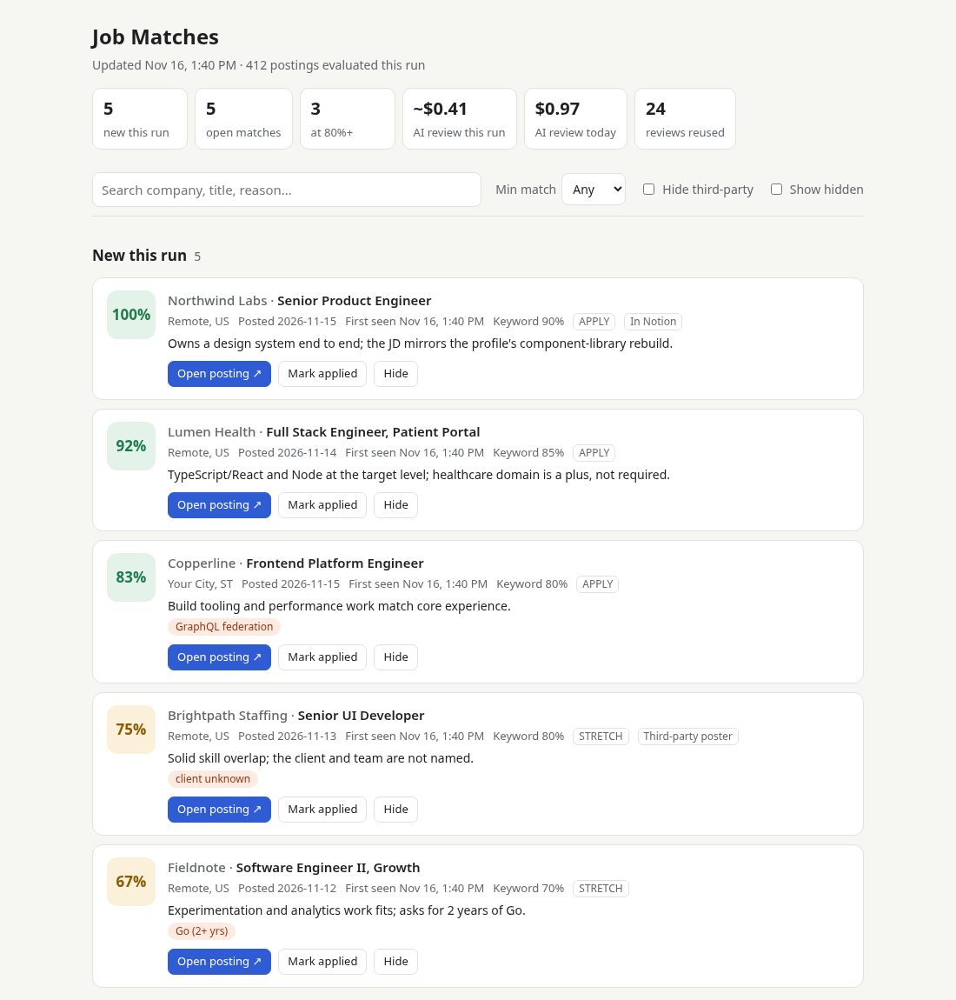

# Job Search Pipeline

Finds job postings that fit you and sends the best ones to Notion, Obsidian, a text file or a web page, with an optional phone notification.

Each run pulls postings from about 1.4 million company job boards (through [job-board-aggregator](https://github.com/Riley-Dorrington/job-board-aggregator)), LinkedIn, Indeed, Remote OK, Jobicy and Hacker News's monthly "Who is hiring?" thread. It drops the ones that break your location, title, pay and experience rules, fetches the full description for the rest, scores them against your skills, and has an AI command-line tool (agy, Claude Code or Codex) grade the best of them against a profile you write.

> **Credit:** the ATS listings, the largest source by far, come from Riley Dorrington's [job-board-aggregator](https://github.com/Riley-Dorrington/job-board-aggregator) (MIT). It indexes 1M+ active postings from 20,000+ companies' Greenhouse, Lever, Ashby, Workday and other boards, refreshed daily by GitHub Actions and published to [job-board-data](https://github.com/Riley-Dorrington/job-board-data). If this pipeline helps you, give that project a star.

Everything specific to your search lives in two files you own: `config.json` (titles, skills, scoring, pay and experience limits, locations, companies to skip, the AI rubric) and `candidate_profile.md` (your background). Both start as copies of tracked templates, [`config.example.json`](config.example.json) and [`candidate_profile.example.md`](candidate_profile.example.md). None of the Python code is tied to one career.

Every run also writes a page of matches you can open in a browser, with no account needed. This one uses made-up data:



---

## Quickstart

Get a first list of matches in your browser, with no Notion, AI reviewer or push notifications. Each can be added later.

```bash
git clone https://github.com/AdnapEngineering/job-search-pipeline.git
cd job-search-pipeline
python3 -m venv .venv && source .venv/bin/activate
pip install -r requirements.txt

cp config.starter.json config.json   # then edit it (see below)
python3 -m job_search_pipeline --check   # flags typos and settings still at their placeholders
python3 -m job_search_pipeline --no-notion --no-llm-review --no-notify
xdg-open data/digest.html            # macOS: open data/digest.html
```

[`config.starter.json`](config.starter.json) holds only the settings you have to change. Replace its placeholders with:

- `sources.search_terms` / `searches`: the job titles to search LinkedIn and Indeed for, and where (your city, or `Remote`).
- `location`: your metro area's name and cities, and `home_states` / `home_timezones` if remote roles must match them.
- `titles`: regexes for titles to keep (`target_patterns`), titles that score highest (`strong_target_patterns`, `primary_role_groups`) and levels to skip.
- `skills_and_scoring`: your skills (`core_strengths`), weighted domain terms (`focus_keywords`) and skills that rule a job out (`hard_exclude_skills`).
- `compensation.min_salary` / `experience.max_min_yoe`: the pay floor and the most years of experience a posting may ask for.

Every other setting keeps its built-in default; [`config.example.json`](config.example.json) lists them all with what they do (see [Configuration](#configuration)). Next steps: write [`candidate_profile.md`](#candidate_profilemd) and [choose an LLM provider](#ai-reviewer) for the AI review, add [Notion](#notion) or [Obsidian](#obsidian) and [ntfy](#environment-variables), and [schedule it with cron](#cron).

---

## Contents

- [Quickstart](#quickstart)
- [How it works](#how-it-works)
   - [How scores are calculated](#how-scores-are-calculated)
- [Setup](#setup)
   - [Updating](#updating)
   - [Install options](#install-options)
   - [Your config and profile](#your-config-and-profile)
   - [Environment variables](#environment-variables)
   - [Notion](#notion)
   - [Checking the setup](#checking-the-setup)
- [Configuration](#configuration)
   - [Location rules](#location-rules)
   - [AI reviewer](#ai-reviewer)
   - [AI review spend and caps](#ai-review-spend-and-caps)
- [Running it](#running-it)
   - [Flags](#flags)
   - [Why was a posting dropped?](#why-was-a-posting-dropped)
   - [Obsidian](#obsidian)
   - [Without Notion](#without-notion)
   - [HTML digest](#html-digest)
   - [Cron](#cron)
   - [Tests](#tests)
- [Troubleshooting](#troubleshooting)
- [Data sources](#data-sources)
- [Files](#files)
- [License](#license)

---

## How it works

```
┌────────────────────────────────────────────────────────────────────────────┐
│ 1. Fetch & filter (sources/: filter.py, linkedin_indeed.py, job_boards.py) │
│    • Streams gzipped ATS chunks (~1.4M rows), LinkedIn, Indeed, Remote OK, │
│      Jobicy, and HN Who's Hiring.                                          │
│    • Applies fast pre-filters (recency, company/recruiter exclusions,      │
│      location/remote eligibility, title matching, salary floor).           │
│    • Re-points aggregator reposts (LinkedIn/Indeed) to the company's own   │
│      direct ATS URL and deduplicates against blocklist.json.               │
└─────────────────────────────────────┬──────────────────────────────────────┘
                                      ▼
┌────────────────────────────────────────────────────────────────────────────┐
│ 2. Fetch job descriptions (scrape.py)                                      │
│    • Fetches each new posting's full description; ones that failed with    │
│      an error last time are tried again.                                   │
│    • Queries structured JSON APIs first (Ashby, Lever, Greenhouse,         │
│      BambooHR, Workday CXS) before HTML fallback.                          │
│    • Detects closed/expired postings, separates requirements sections      │
│      from company boilerplate, and extracts matched skills.                │
└─────────────────────────────────────┬──────────────────────────────────────┘
                                      ▼
┌────────────────────────────────────────────────────────────────────────────┐
│ 3. Keyword scoring (evaluate.py)                                           │
│    • Screens JD body for hidden onsite/hybrid/foreign-residency rules.     │
│    • Distinguishes hard requirements from "nice-to-have / preferred"       │
│      sections and multi-language alternatives ("Skill A or Skill B").      │
│    • Enforces YOE ceilings (ignoring degree-equivalency boilerplate).      │
│    • Computes a 0–100% keyword score and deduplicates by company|title.    │
└─────────────────────────────────────┬──────────────────────────────────────┘
                                      ▼
┌────────────────────────────────────────────────────────────────────────────┐
│ 4. AI review (review.py)                                                   │
│    • Reuses cached reviews (also for reposts), records token/USD spend,    │
│      and stops at the configured per-run / per-day caps.                   │
│    • Drops roles already in Notion blocklists, and remote roles limited to │
│      other states/time zones, before spending LLM quota.                   │
│    • Grades each match against candidate_profile.md on a 12-point rubric:  │
│      hard_reqs (0–4), core_work (0–3), evidence (0–3), level (0–2).        │
│    • Verifies verbatim evidence_quote against the JD to prevent            │
│      made-up evidence; Python computes the final Match % and verdict.      │
└─────────────────────────────────────┬──────────────────────────────────────┘
                                      ▼
┌────────────────────────────────────────────────────────────────────────────┐
│ 5. Outputs and notifications (outputs/: notion.py, obsidian.py,            │
│    text_export.py, html_digest.py)                                         │
│    • Rewrites data/digest.html, a self-contained page of matches.          │
│    • Syncs qualified matches (>= min_score) to a Notion database, writes   │
│      them as notes in an Obsidian vault, and/or appends them to a .txt log.│
│    • Appends output URLs and company|title keys to persistent blocklists.  │
│    • Updates the Notion Callout / Obsidian summary note, saves Markdown    │
│      summary, and sends a push notification with source-health warnings.   │
└────────────────────────────────────────────────────────────────────────────┘
```

### How scores are calculated

A posting gets two scores. Stage 3 computes a **keyword score** from the JD text; Stage 4's AI review then replaces it with the final **Match %**, which is what `--min-score` and the outputs use. Default values are shown; every one is a setting in `config.json`.

| | Stage 3: keyword score (`evaluate.py`) | Stage 4: Match % (`review.py`) |
| :--- | :--- | :--- |
| **Start** | `base_score` (20) | `round(100 × (hard_reqs + core_work + evidence + level) / 12)`, graded 0–4, 0–3, 0–3, 0–2 (`llm_review.components`) |
| **Add** | Title credit: a `primary_role_groups` match (its `points`, 20) or a `strong_target_patterns` match (20); a generic title with your core stack scores 10, or 20 when the JD shows enough target work (`generic_body_signal_min`) |  |
| | `core_strengths`: 5 each (`core_strength_points`, or a skill's own weight in `core_strength_weights`), up to `core_strengths_cap` (40) |  |
| | `focus_keywords`: their weights, up to `domain_score_cap` (30); synonyms listed together in `focus_keyword_groups` count once, at the group's highest weight |  |
| **Subtract** | `soft_skill_penalty` (5) for each excluded skill listed as optional, up to `soft_skill_penalty_cap` (15); each `penalized_keywords` weight (not when the term is only offered beside an accepted skill, as in "React, Vue or Angular"); each matching `hard_ask_penalties` entry; `top_yoe_penalty` (10) when the JD asks `max_min_yoe`+ years | `pay_midpoint_penalty` (10) when the pay band's midpoint is under `min_salary` (unless its top reaches `pay_midpoint_max_cap`); an evidence grade of 3 without a verbatim quote from the JD counts as 2 |
| **Cap** | 100 | `blocker_cap` (30) when hard_reqs is 0 or logistics fail; `level_mismatch_cap` when level is 0; `core_work_caps` per core_work grade (template: 30 at 0, 65 at 1); the pay-floor cap when the band tops out under `min_salary` (see [`compensation`](#configuration)) |
| **Then** | ≥ `strong_floor` (75): Strong; ≥ `secondary_floor` (55): Secondary; below: dropped. Matches ≥ `--review-min-score` (55) go to the AI review | ≥ `apply_min_score` (follows `min_sync_score`, 80): **APPLY**; ≥ `stretch_min_score` (50): **STRETCH**; below: **SKIP** (listed as filtered by AI review). APPLY is what gets synced at the default `--min-score`. Equal Match % sort by keyword score |

For example, a posting whose title matches a primary role group, that names 6 of your core strengths (5 points each) and one 15-point focus keyword, and that asks for `max_min_yoe`+ years scores 20 + 20 + 30 + 15 − 10 = **75** (Strong), so it goes to review. The reviewer grades hard_reqs 3, core_work 3, evidence 3 (with a verified quote) and level 2: 11/12 = **92%**, APPLY, synced. Had its pay midpoint been under your floor, it would be 82%: still APPLY. Had the reviewer graded hard_reqs 0, it would be capped at 30%: SKIP.

With `--no-llm-review` (or no AI reviewer installed), the keyword score is the Match %. Cached reviews are rescored from their stored grades on every run, so changing these settings never requires new reviews.

---

## Setup

The [Quickstart](#quickstart) covers cloning, the virtualenv, dependencies and your first config. This section covers the rest: updates, install options, secrets, Notion and the setup check. Python 3.10+ is required.

### Updating

```bash
git pull origin main
```

Your settings live in `config.json` and your background in `candidate_profile.md`. Git ignores both, so pulling never touches them. New settings arrive in the tracked template `config.example.json`; after a pull, `git diff HEAD@{1} -- config.example.json` shows what was added so you can copy the keys you want into your own file. Any key you leave out keeps its built-in default.

<details>
<summary>Upgrading from an earlier version? (one-time steps)</summary>

If you're upgrading from before the `job_search_pipeline/` package: the code moved from loose scripts at the root into the `job_search_pipeline/` folder. `run_job_search.sh`, cron lines that call it, your `config.json`, `candidate_profile.md`, `.env` and `data/` all keep working unchanged. If you ran a script directly, use the new command: `python3 run_pipeline.py` is now `python3 -m job_search_pipeline`, and `python3 check_setup.py` is `python3 -m job_search_pipeline --check`.

If you're upgrading from a version where `config.json` and `candidate_profile.md` were tracked: that pull removes both files from the repository, so git refuses to run it while your edited copies are in the way. Set your copies aside, pull, and put them back:

```bash
mkdir -p ~/job-pipeline-backup
cp config.json candidate_profile.md ~/job-pipeline-backup/   # keep your settings and profile
git checkout -- config.json candidate_profile.md             # restore the tracked versions so the pull can remove them
git pull origin main
cp ~/job-pipeline-backup/config.json ~/job-pipeline-backup/candidate_profile.md .   # yours again, now ignored by git
```

If you never edited either file, just pull, then create your copies as described under [Your config and profile](#your-config-and-profile).

</details>

### Install options

The Quickstart's `pip install -r requirements.txt` inside `.venv` is all a run needs; `run_job_search.sh` uses `.venv`'s Python automatically when it exists, even from cron. Two extras:

```bash
pip install -e .                      # adds a `job-search` command, same as `python3 -m job_search_pipeline`
pip install -r requirements-dev.txt   # ruff, for development (see Tests)
```

### Your config and profile

```bash
cp config.starter.json config.json         # just the settings you must change; or copy config.example.json for all of them
cp candidate_profile.example.md candidate_profile.md
```

Run the pipeline (and cron) straight from your clone: `config.json`, `candidate_profile.md`, `.env`, `data/`, the log and the summary are all ignored by git, so `git pull` updates the code and leaves them alone. To keep extra personal files in the clone (your own scripts or notes), list them in `.git/info/exclude`, which works like `.gitignore` but is never committed.

Edit the copies, not the templates: see [Configuration](#configuration).

To skip most of the hand-editing, write `candidate_profile.md` first and let the AI reviewer's CLI draft the career-specific settings from it, optionally reading up to three postings you would want:

```bash
python3 -m job_search_pipeline --init-config                       # from candidate_profile.md alone
python3 -m job_search_pipeline --init-config URL1 URL2 URL3        # also learn from sample postings
```

It fills in `sources.search_terms`, the title patterns, `core_strengths` and their weights, `focus_keywords`, `hard_exclude_skills`, `max_min_yoe`, the AI review's `calibration_examples` and, when the profile says where you live, the location settings, on top of `config.starter.json`. Each field is type-checked and every regex compiled before anything is written; invalid ones are dropped and listed. The draft goes to `config.draft.json` (ignored by git), never over your `config.json`: review it, copy it over or merge in the parts you want, and run `--check`, which flags anything still at a placeholder (`sources.searches` always needs your city). It makes one call to the [configured provider](#ai-reviewer), with up to 10 minutes to answer. Until `config.json` exists the pipeline runs on the template's placeholder values and prints a reminder. Until `candidate_profile.md` exists the AI review is skipped (the placeholder profile is never sent to the LLM) and matches are output on their keyword scores.

### Environment variables

Secrets and machine-specific values go in `.env` (or `~/.config/notion/job-search.env`), never in git:

```bash
cp .env.example .env
chmod +x run_job_search.sh
```

```bash
NOTION_TOKEN="ntn_your_secret_token"
NOTION_DATABASE_ID="your-32-char-database-id"
NOTIFY_URL="https://ntfy.sh/your-topic"
```

Every variable is optional; without them the pipeline still runs end to end and writes the HTML digest.

| Variable | What it sets | Config equivalent |
| :--- | :--- | :--- |
| `NOTION_TOKEN` | Notion integration secret (`NOTION_API_KEY` also works). | `notion.notion_token` (prefer the variable) |
| `NOTION_DATABASE_ID` | The Notion database to sync matches to. | `notion.database_id` |
| `OBSIDIAN_VAULT` | Path of the Obsidian vault to write notes to (`obsidian.enabled` must still be true). | `obsidian.vault_path` |
| `NOTIFY_URL` | `ntfy` topic URL for push notifications. | `notifications.notify_url` |
| `JOB_PIPELINE_CONFIG` | Path of a different config file, e.g. one per career. |  |
| `JOB_SEARCH_LOG_MAX_BYTES` | Size at which `cron_job_search.log` is trimmed (default 5 MB; `0` turns trimming off). Read by `run_job_search.sh` only. |  |

The pipeline reads these from its process environment. `run_job_search.sh` (and so cron) loads `~/.config/notion/job-search.env` and then `.env` first, so a value in `.env` wins when both set it; `--check` reads both files the same way. A direct `python3 -m job_search_pipeline` run does **not** load either file: export the variables in your shell first, or run through the wrapper.

### Notion

Notion is optional (see [Obsidian](#obsidian) and [other platforms](#without-notion)). To use it:

1. Create an integration at [notion.so/my-integrations](https://www.notion.so/my-integrations) and copy its secret into `NOTION_TOKEN`.
2. Create a database with these properties, named exactly as shown (any other properties you add are left alone), and copy its ID (the 32 characters in its URL) into `NOTION_DATABASE_ID`:

   | Property | Type |
   | :--- | :--- |
   | `Company & Stage` | Title |
   | `Role Title & Compensation` | Text |
   | `Location` | Text |
   | `Why It Matches` | Text |
   | `Match %` | Text |
   | `Link` | URL |
   | `Date Posted` | Date |
   | `Originally Posted` | Date (optional) |

3. Connect the integration to the database: open the database, choose **••• → Connections** and add your integration. Skipping this is the usual cause of 404 errors.
4. Run `python3 -m job_search_pipeline --check`. It confirms the token works, the database is reachable, and every property exists with the right type.

The first run also adds a run-summary Callout below the database on its parent page, and remembers it in `notion.summary_block_id`.

### Checking the setup

```bash
python3 -m job_search_pipeline --check
```

The check fetches no jobs, spends no AI quota and writes nothing. It reports, one line each: Python version and installed dependencies; which config file is read, unknown keys (with a "did you mean" for typos) and career settings still at the template's placeholder values; whether `candidate_profile.md` exists; whether the AI reviewer's CLI is found; when Notion is configured, whether the token works and the database has every property the sync writes (its only network call); and, when Obsidian is on, whether the vault folder exists and is writable. It reads `.env` and `~/.config/notion/job-search.env` the way the cron wrapper does. It exits 1 when something would make a run fail (✗), and 0 when there are only warnings (!).

---

## Configuration

### candidate_profile.md
Create it from the template first if you have not already (`cp candidate_profile.example.md candidate_profile.md`). Describe your background honestly; the AI review grades every posting against it. Editing the file makes the cached reviews out of date, so open matches are reviewed again on the next run. Include:
- Your total years of experience, and years with each core tool or skill.
- The tools, certifications and specialties you don't have.
- Specific accomplishments ("Strongest Evidence") that a well-matched job description would mirror.
- The levels you're aiming for, and anything that rules a job out.

### config.json
Create it first if you have not already: `cp config.starter.json config.json` gives you only the career-specific settings, while `cp config.example.json config.json` copies every setting. The template [`config.example.json`](config.example.json) lists every setting: built-in defaults for the general ones, placeholders for the career-specific ones. In your copy, delete any setting you leave at its default; a missing key uses the built-in default, so only what you change needs to be there, and later default improvements reach you.

| Section | What to set |
| :--- | :--- |
| `paths` | Where data files (`filtered_jobs`, `enriched_jobs`, `blocklist`, `review_cache`, `llm_spend`, `text_export`, `html_digest`, `digest_store`, ...) and `candidate_profile` live. Relative paths resolve from the repository directory; `~` is expanded. |
| `sources` | `lookback_days`, LinkedIn/Indeed `search_terms` and `searches` (`[site, location, suffix, count]`), the `*_enabled` switches, and the `jobicy_url` industry parameter. |
| `location` | `allow_remote`, your metro (`local_metro_patterns`, `local_metro_exclude_patterns`), `home_states` / `home_timezones` for state- or zone-limited remote roles, and the foreign-place lists. See [Location rules](#location-rules). |
| `compensation` | `min_salary` (annual USD floor; `min_salary: 0` disables pay filtering), `pay_midpoint_max_cap` and `pay_midpoint_penalty`, and `pay_floor_taper_from` to soften the floor's cap.<sup>1</sup> |
| `experience` | `max_min_yoe` (most years a JD may ask), `max_min_secondary_yoe`, `reject_clearance` with `clearance_ignore_terms` (e.g. `["public trust"]`), and `reject_foreign_language_req`.<sup>2</sup> |
| `titles` | `target_patterns` (Stage 1 pre-filter), `strong_target_patterns`, `primary_role_groups` (title bonus), `primary_role_patterns`, and the lists that reject titles: `exclude_seniority_patterns`, `exclude_tech_patterns`, `exclude_role_patterns` and `soft_exclude_role_patterns`.<sup>3</sup> |
| `companies` | `exclude_companies`, `exclude_recruiters` (staffing agencies/aggregators), `allow_recruiters`, and `company_aliases` (parent company → brand). |
| `skills_and_scoring` | `core_strengths` (with optional per-skill `core_strength_weights`), `focus_keywords` (with `focus_keyword_groups` for synonyms), `hard_exclude_skills`, `hard_ask_penalties`, `off_center_role_check`, and the score floors and caps in [How scores are calculated](#how-scores-are-calculated). |
| `llm_review` | `provider` and `model`, `rubric_descriptions` and 3–8 `calibration_examples` for your career, score caps and verdict thresholds, `hide_third_party`, spending limits in `budget` and prices in `pricing`.<sup>4</sup> |
| `url_normalization` | `aggregator_hosts` (job boards whose links are re-pointed to the employer's posting) and `extra_tracking_params`. The defaults suit most searches. |
| `notion` | `database_id` (or `NOTION_DATABASE_ID`), and optionally `summary_page_id` for the run-summary Callout. `summary_block_id` is filled in automatically. See [Notion](#notion). |
| `obsidian` | `enabled`, `vault_path` (or `OBSIDIAN_VAULT`), `folder`, `summary_note` and `tag`. See [Obsidian](#obsidian). |
| `text_export` | `enabled: true` appends new qualified matches to `paths.text_export` (`data/job_matches.txt`). |
| `html_digest` | On by default, written to `paths.html_digest` (`enabled: false` turns it off); set `title`, `keep_days` (default 30) and `url` if you host the page. See [HTML digest](#html-digest). |

<sup>1</sup> A posting whose band tops out below `min_salary` is capped at `llm_review.blocker_cap`. With `pay_floor_taper_from` (a figure below `min_salary`), the cap instead rises in a straight line from `blocker_cap` at `pay_floor_taper_from` to 100 at `min_salary`; `0` keeps the cliff.

<sup>2</sup> For years of experience, a range such as "5-8+ years" counts as its lower bound, and figures quoted for another level or as "ideally"/nice-to-have are ignored. A clearance listed only under a preferred or "ways to stand out" section does not reject a posting.

<sup>3</sup> `primary_role_groups` give their `points` (default +20); `primary_role_patterns` boost LinkedIn/Indeed titles by 20. `exclude_role_patterns` reject a title outright; `soft_exclude_role_patterns` reject it unless it also matches `strong_target_patterns`, so there's no need to repeat them in both.

<sup>4</sup> `apply_min_score` is the Match % at which the verdict reads APPLY; leave it out to follow `skills_and_scoring.min_sync_score`, so APPLY always means "will be synced". `level_mismatch_cap` caps a role graded level 0 (under- or over-leveled), so strong skill overlap cannot lift a junior or executive role to APPLY; the template sets 65, and leaving it out means no cap. `core_work_caps` does the same per core_work grade, so mostly-backend or off-target work cannot reach APPLY on requirement and domain overlap alone; the template caps grade 0 at 30 and grade 1 at 65, and leaving it out means no cap. `hide_third_party: true` drops postings flagged as coming from a staffing agency, recruiter or aggregator, as if skipped; the default `false` only labels them. Tune `repost_similarity` too; see [AI review spend and caps](#ai-review-spend-and-caps).

<details>
<summary>Legacy key names that are still read</summary>

Configs written before some lists were merged keep working; these keys are read and added to their current equivalents, and `--check` does not flag them:

| Legacy key | Added to |
| :--- | :--- |
| `location.foreign_exclude_patterns`, `jd_non_allowed_locations`, `jd_foreign_places`, `jd_foreign_terms`, `foreign_countries` | `location.foreign_places` / `foreign_cities` |
| `titles.bad_role_patterns`, `soft_bad_role_patterns` | `titles.exclude_role_patterns`, `soft_exclude_role_patterns` |
| top-level `notify_url`, `notion_token`, `summary_block_id` | `notifications.notify_url`, `notion.notion_token`, `notion.summary_block_id` |

</details>

#### Location rules

- Set `home_states` (e.g. `["CO"]`) and `home_timezones` (any of `eastern`, `central`, `mountain`, `pacific`) to drop remote roles restricted to other states or zones ("Remote - TX", "must reside in MA, IN, or TX", "must be located in the Eastern time zone") before the LLM review. Both rules are off while the lists are empty.
- `foreign_places` (countries, regions, provinces) rules out a feed location or title that names one and not your country, JD residency wording ("remote within Canada", "anywhere in Australia") and a JD `Location:` line. `foreign_cities` only rules out a JD `Location:` line, since a city name alone can be a town in your country (Dublin, OH). Entries are lower-case regex fragments matched as whole words.
- `local_metro_exclude_patterns` drops a city in your metro's name that is in another state.
- If you're searching from outside the US: both foreign lists default to a US-based search (shown in the template). Set `allowed_country_pattern` and `country_token_pattern` to your own country and replace both lists.

#### Where the config is read from

- The pipeline reads `config.json` from the repository directory. It is your own copy of the tracked template `config.example.json` and is ignored by git. Set `JOB_PIPELINE_CONFIG=/path/to/other.json` to use a different file (e.g. one per career).
- If `config.json` does not exist yet, the template `config.example.json` is read instead and a reminder is printed to stderr. The template itself is never written to.
- If a file named by `JOB_PIPELINE_CONFIG` is missing, every setting falls back to its built-in default. If a config file is not valid JSON, the run stops with the file, line and column of the error. `python3 -m job_search_pipeline --check` also catches unknown keys, such as typos, which would otherwise be ignored.
- The Notion logger only writes `summary_block_id` back when `config.json` parsed cleanly, so a typo in the file is never overwritten. If `config.json` does not exist yet, it is created as a copy of the template with the block id added.

### AI reviewer

By default (`"provider": "auto"`, or no `provider` at all) the pipeline uses the first of these CLIs it finds installed, in the order listed, and reports which one in `--check`. agy comes first so existing agy setups and their review caches carry on unchanged; on a machine without it, Claude Code is used. To pin one, edit the `llm_review` object in `config.json`; keep its other rubric settings:

| Provider | Settings to change | Setup |
| :--- | :--- | :--- |
| agy | `"provider": "agy"` (default model `gemini-4-hydrogen-medium`) | Install and configure `agy`; set `agy_path` if needed. |
| Claude Code | `"provider": "anthropic"` (default model `sonnet`) | Install [Claude Code](https://code.claude.com/docs/en/quickstart) and sign in; optionally set `claude_path`. |
| OpenAI Codex | `"provider": "openai"` (default: the model in Codex's own config) | Install [Codex CLI](https://developers.openai.com/codex/cli/) and run `codex login`; optionally set `codex_path`. |

Leave `model` empty to use the provider's default above, or set a model or alias supported by the selected CLI and available to your account. A `model` you set is kept when `provider` changes, so clear it when switching. `claude_path` and `codex_path` can specify an executable path; otherwise they are found on `PATH`. `timeout_seconds` and `workers` apply to all CLIs.

The pipeline uses CLI authentication; it does not call Anthropic or OpenAI APIs directly or require pipeline-specific API keys. Sign in under the same OS user that runs the pipeline, and check that your plan permits CLI usage. For cron, ensure that user's home directory, authentication, and `PATH` are available; the wrapper supplies a standard PATH including `~/.local/bin`, or configure an explicit CLI path.

CLI reviews send the candidate profile and selected job details to the provider and can consume subscription limits or incur charges depending on authentication and plan. Review the provider's data and retention policies. Each eligible uncached job can trigger a CLI invocation. Cached reviews are separated by provider, model, profile, prompt, and review version. Existing agy cache entries remain compatible.

Claude runs with built-in tools disabled, MCP auto-configuration and slash commands disabled, and session persistence off. Codex runs in a read-only sandbox with ephemeral sessions. Both run from an empty temporary directory, but CLI configuration and managed policies can still affect behavior; review them before running on sensitive data. Codex may still use tools permitted by its sandbox and configuration.

If a review times out, fails, or returns an invalid/incomplete reply, the pipeline reports the problem and keeps the job's keyword score, but holds the job back: it is listed in the summary as `[AI review failed, held for retry]`, is not synced or exported, and is reviewed again on the next run. If the CLI is not installed at all (or `candidate_profile.md` has not been created from its template), the stage is skipped and matches are output on their keyword scores, as with `--no-llm-review`, but unlike that flag the skip is flagged: the push notification is sent at high priority with "(AI review skipped)" in its title and the reason as a ⚠️ line, and the HTML digest shows the same warning at the top. An unknown provider is a configuration error.

The review also flags postings that come from a staffing agency, recruiter, consultancy or aggregator rather than the employer. The flag never changes the score: flagged roles sync as usual, with `[Third-party poster]` at the start of the "Why It Matches" text in Notion, the Markdown summary and the `.txt` export, and a count in the push notification.

Cached reviews made under an older profile, prompt, model or provider can never be read again and are pruned on the next run. The Match % and verdict of a cached review are recomputed from its stored grades on every run, so changes to `min_sync_score`, `apply_min_score` or the pay rules apply without paying for new reviews. Editing the profile, rubric or calibration examples still re-reviews every open match once.

A posting with a new URL is not reviewed again when it is a repost of one already reviewed: either the JD text is identical, or the company and title match and the JD text is at least `repost_similarity` alike (0–1, default `0.8`, estimated from a small fingerprint stored with each review). This covers the same role on LinkedIn and on the company's ATS, and reposts under a new ID with small edits. Reviews cached before this feature have no fingerprint, so only reviews made since then can be matched this way.

### AI review spend and caps

Every run records what the review used, in `paths.llm_spend` (`data/llm_spend.json`, kept for 90 days): calls made, reviews reused from the cache or from reposts, input/cached/output tokens, and cost. The figures appear in the console log, the push notification, the Markdown summary and the HTML digest (this run and today).

How cost is known depends on the CLI:

| Provider | Tokens | Cost in USD |
| :--- | :--- | :--- |
| Claude Code (`anthropic`) | Reported | Reported by the CLI (`total_cost_usd`); no setup needed. On a subscription this is the API-equivalent figure, not a charge. |
| Codex (`openai`) | Reported | Estimated from `pricing` when you set it; otherwise tokens only. |
| agy | Reported | Estimated from `pricing` when you set it; otherwise tokens only. |

Prices are USD per million tokens, either keyed by provider (so switching `provider` picks up the right rates) or flat (applied to whichever provider is configured):

```json
"pricing": {
  "openai": { "input_per_mtok": 1.25, "cached_input_per_mtok": 0.125, "output_per_mtok": 10 }
}
```

Caps go in `llm_review.budget`. Every cap defaults to `0`, which means no limit:

| Key | Limit |
| :--- | :--- |
| `max_reviews_per_run` | New reviews per run (cached and repost reviews are free and never count). |
| `max_tokens_per_run` / `max_tokens_per_day` | Tokens per run / per calendar day across runs. Good for subscription CLIs, where quota is counted in tokens. |
| `max_usd_per_run` / `max_usd_per_day` | Dollars per run / per day. Needs a reported cost (Claude) or `pricing`; without either, cost is unknown and these caps cannot trigger, so use a token cap. |

```json
"budget": { "max_reviews_per_run": 20, "max_tokens_per_day": 600000, "max_usd_per_day": 1.50 }
```

Reviews run highest keyword score first. Each one reserves its estimated cost (prompt length, plus the average output of earlier reviews) before it starts, so reviews running in parallel cannot jointly pass a cap. When the next review would pass a cap, the pass stops: the remaining matches are **deferred**, i.e. held like a failed review (`[AI review deferred: budget cap reached, held for next run]`, not synced or exported) and reviewed first on a later run. Real usage can still run over a cap slightly when a reply is longer than estimated.

---

## Running it

### Running a search

```bash
./run_job_search.sh
```

Or invoke the package directly with flags (`job-search` works the same after `pip install -e .`):

```bash
# Dry run: evaluate and generate Markdown without syncing to Notion or sending notifications
python3 -m job_search_pipeline --no-notion --no-notify --md-output latest_job_summary.md

# Re-evaluate already-scraped jobs in data/enriched_jobs.json after tweaking config.json
python3 -m job_search_pipeline --skip-fetch --skip-scrape --no-notion --no-notify --md-output latest_job_summary.md

# Skip the LLM review step (use Stage 3 keyword scores only)
python3 -m job_search_pipeline --no-llm-review --min-score 75
```

### Flags

| Flag | Description |
| :--- | :--- |
| `--check` | Check the setup and exit without running (same as `python3 -m job_search_pipeline.check`); see [Checking the setup](#checking-the-setup). |
| `--explain URL` | Trace one posting through the Stage 1 filters, every Stage 3 rule and the score breakdown, then exit; see [Why was a posting dropped?](#why-was-a-posting-dropped). `--title`, `--company` and `--location` fill in a posting the pipeline has not seen; `--rescrape` fetches its description again. |
| `--init-config [URL ...]` | Draft the career-specific settings from `candidate_profile.md` (and up to 3 sample postings) with the AI reviewer's CLI, write them to `config.draft.json`, then exit; see [Your config and profile](#your-config-and-profile). `--init-output PATH` writes elsewhere; `--force` overwrites an existing file there. |
| `--skip-fetch` | Skip Stage 1 (`sources/filter.py`) and reuse `data/filtered_jobs.json`. |
| `--skip-scrape` | Skip Stage 2 (`scrape.py`) and reuse `data/enriched_jobs.json`. |
| `--no-llm-review` | Skip Stage 4 (`review.py`) and keep Stage 3 keyword scores. |
| `--no-notion` | Skip syncing matches to Notion. |
| `--no-notion-log` | Skip updating the Notion parent-page Callout summary block. |
| `--obsidian-vault PATH` | Write new matches as notes in the Obsidian vault at `PATH` (overrides `obsidian` in `config.json`). |
| `--no-obsidian` | Skip the Obsidian notes even when enabled in `config.json`. Cannot be combined with `--obsidian-vault`. |
| `--no-obsidian-log` | Write the Obsidian notes but skip rewriting the run-summary note. |
| `--no-notify` | Skip sending the `ntfy` push notification. |
| `--min-score INT` | Minimum Match % to sync to Notion / Obsidian / export to `.txt` (defaults to `skills_and_scoring.min_sync_score`, `80`). |
| `--review-min-score INT` | Minimum Stage 3 keyword score to send to LLM review (defaults to `55`). |
| `--md-output PATH` | Write a Markdown summary table of matches, manual reviews, and skips to `PATH`. |
| `--txt-output PATH` | Append new qualified matches to `PATH` (overrides `text_export` in `config.json`). |
| `--no-txt-export` | Skip exporting matches to a `.txt` file even when enabled in `config.json`. Cannot be combined with `--txt-output`. |
| `--html-output PATH` | Write the HTML digest to `PATH` (overrides `html_digest` in `config.json`). |
| `--no-html` | Skip the HTML digest even when enabled in `config.json`. Cannot be combined with `--html-output`. |

### Why was a posting dropped?

Every run counts what each deterministic rule dropped: the Stage 1 pre-filters per source (title, location, company, pay and, for LinkedIn/Indeed, the keyword gate) and every Stage 3 rule (seniority, title, feed location, missing JD location, `hard_exclude_skills`, `avoid_keywords`, `conditional_require_any`, clearance, language, `specialty_reject_rules`, `max_min_yoe`, `max_min_secondary_yoe`, `off_center_role_check`, `max_senior_role_years`, and scoring under `secondary_floor`). The HTML digest shows this as a collapsed **Dropped by deterministic rules** table, and `--md-output` as a collapsible section, each with the count per rule and an example posting with the exact phrase that matched. A rule dropping far more than you expect is the first place to look when matches dry up. Stage 3 counts cover every posting in the lookback window, so a posting is counted again on each run it stays in the window. Stage 1 leaves out the ATS feed's rows older than `lookback_days`, which are most of the feed's archive.

To see exactly why one posting was dropped or scored as it was:

```bash
python3 -m job_search_pipeline --explain 'https://jobs.lever.co/acme/123'
```

It prints each Stage 1 filter and Stage 3 rule with ✓ or ✗ and what matched, then the score line by line (base, title credit, each core strength and domain term with its points, each penalty) and the tier it lands in. For a dropped posting it also shows what it would have scored without the rule that dropped it, which tells you whether loosening that rule would let a good match through. A posting that passes goes on to the location-wording check and the blocklist. The posting's company, title and location come from `data/enriched_jobs.json` or `data/filtered_jobs.json` when the pipeline has seen it; for a new one the company is guessed from the URL and `--title` / `--location` fill in the rest. Quote the URL, since shells treat `?` and `&` specially. It reads your current `config.json`, so you can edit a rule and run it again to see the effect.

### Obsidian

Instead of (or as well as) Notion, the pipeline can write each new match as a note in an Obsidian vault. The vault is just a folder, so Obsidian doesn't need to be running, and the notes sync like any others (Obsidian Sync, iCloud, Syncthing, git).

Turn it on in `config.json`, or set `OBSIDIAN_VAULT` in `.env` in place of `vault_path`:

```json
"obsidian": {
  "enabled": true,
  "vault_path": "~/Documents/MyVault",
  "folder": "Job Prospects",
  "summary_note": "Job Search Run Summary",
  "tag": "job-prospect"
}
```

Or per run: `./run_job_search.sh --obsidian-vault ~/Documents/MyVault`. For Obsidian only, also leave Notion unset (see below) or pass `--no-notion`.

Each match at or above `--min-score` becomes `<folder>/<Company> - <Title>.md`. Its frontmatter holds the same fields as the Notion database, shown as Obsidian Properties:

```markdown
---
company: "Example Corp"
role: "Senior Specialist"
location: "Remote"
match: 92
link: "https://example.com/jobs/123"
date_added: 2026-11-16
originally_posted: 2026-11-12
status: Prospect
tags:
  - job-prospect
---

## Why It Matches

APPLY: Strong skill alignment (keyword score 85%)
```

Change `status` or add your own notes freely: an existing note is never overwritten. To get a table like the Notion database, create a Base (or a Dataview `TABLE company, role, match, status FROM #job-prospect SORT match DESC`). Each run also rewrites `<folder>/Job Search Run Summary.md` with the same counts, top matches and recent runs as the Notion Callout (`--no-obsidian-log` skips it).

Written roles go into the same blocklists as Notion and the `.txt` export. When Notion is also on, Notion does the blocklisting, so a role that fails to reach Notion is retried next run (its Obsidian note is left as it is). `--check` reports whether the vault folder exists and is writable.

### Without Notion

Notion is optional. If you use Obsidian, see [above](#obsidian). If you track applications somewhere else (Confluence, a wiki, a spreadsheet, a plain notes folder), turn off Notion writes and have the pipeline write matches to a text file instead.

To turn off Notion:

| Scope | How |
| :--- | :--- |
| One run | Pass `--no-notion` (skips both the database sync and the run-summary Callout). Pass `--no-notion-log` to keep the sync but skip only the Callout. |
| Permanently | Leave `notion.database_id` empty in `config.json` and don't set `NOTION_DATABASE_ID` / `NOTION_TOKEN`. Both Notion steps then skip themselves with a notice, and no token is needed. |

Matches still reach the [HTML digest](#html-digest) with no setup. To also write them to a `.txt` file, turn it on in `config.json`:

```json
"paths": { "text_export": "data/job_matches.txt" },
"text_export": { "enabled": true }
```

Or per run from the command line:

```bash
# Text file only, no Notion
python3 -m job_search_pipeline --no-notion --txt-output ~/Documents/job_matches.txt

# Through the cron wrapper (arguments passed to the wrapper replace its default --md-output)
./run_job_search.sh --no-notion --txt-output ~/Documents/job_matches.txt --md-output latest_job_summary.md
```

Each run appends a timestamped block containing only matches at or above `--min-score` that haven't been output before:

```text
===== Job Search Run 2026-11-13 09:25 — 2 new match(es) (min score 80%) =====

[92%] Example Corp — Senior Specialist
    Location: Remote
    Posted: 2026-11-12
    Why: APPLY: Strong skill alignment (keyword score 85%)
    Link: https://example.com/jobs/123

[84%] Another Co — Target Role 1
    Location: Your City, ST
    Posted: 2026-11-11
    Why: STRETCH: Matches core work; one tool gap. Gaps: tool_b.
    Link: https://jobs.example.org/456
```

Roles are matched by `company|title`, and also by JD text plus title, so the same posting under another company name (a brand and its parent, a reposter) is one role. Exported roles are added to the same URL and role blocklists (`data/blocklist.json`, `data/blocklist_roles.json`) that Notion sync uses, so a role is written once and reposts on other boards are skipped. If Notion or Obsidian is also active, that output handles the blocklisting instead, so a role that fails to reach it is retried on the next run (and may appear in the `.txt` again). To re-export everything from scratch, delete those two blocklist files.

For other formats, `--md-output PATH` writes the full Markdown table (matches, manual reviews, AI skips, location drops, drop counts per rule), overwritten each run. `data/evaluated_jobs.json` holds the raw Stage 3 results as JSON for custom integrations.

### HTML digest

Every run writes `data/digest.html`, a single page with no external scripts that works offline. The [screenshot](#job-search-pipeline) at the top shows one. Open it with:

```bash
xdg-open data/digest.html   # macOS: open data/digest.html
```

It lists matches in three groups: **New this run**, **Still open** (seen before and again now), and **Earlier** (no longer in the run because the posting closed, was reposted, or was already sent to Notion or the `.txt` export; kept for `keep_days`). Each card shows the Match %, the AI verdict and reason, the gaps, and badges for third-party posters, roles already in Notion, and held reviews. Search, a minimum-match filter and a "hide third-party" toggle sit at the top. Below the matches are this run's AI-filtered roles, location drops, failed scrapes and the [drop counts per rule](#why-was-a-posting-dropped), plus source counts, source warnings and AI review spend.

**Mark applied** and **Hide** remember your choice in that browser only (local storage); they do not change the pipeline's blocklists. The matches behind the page are kept in `paths.digest_store` (`data/digest_matches.json`), so the page keeps matches from earlier runs even though each run only finds new ones.

To open the page from your phone, serve the folder (for example `python3 -m http.server -d data 8080` on your home network, or any static host) and set `html_digest.url` to its address. The push notification then opens the digest when tapped; without a `url`, the notification shows the file path.

### Cron

To run at 7:10, 12:10 and 19:10:

```cron
10 7,12,19 * * * /path/to/job-search-pipeline/run_job_search.sh
```

The wrapper appends every run to `cron_job_search.log` next to the scripts. When the log passes 5 MB, the wrapper keeps its newest half at the start of the next run. Set `JOB_SEARCH_LOG_MAX_BYTES` in `.env` to change the limit, or to `0` to turn trimming off (for example, to manage the file with `logrotate` instead).

The ATS feed is refreshed once a day, usually between about 15:00 and 19:00 UTC; runs before that see the previous day's snapshot, and the pipeline warns when the feed is more than `sources.feed_stale_hours` (36) old.

### Tests

```bash
pip install -r requirements-dev.txt   # ruff, pinned to the version CI uses
ruff check .
python3 -m unittest discover -s tests
```

GitHub Actions runs the same lint and tests on Python 3.10 and 3.13 for every pull request and push to `main` ([`.github/workflows/ci.yml`](.github/workflows/ci.yml)).

The tests load `tests/fixtures/search_config.json` (a made-up search) through `tests/_fixture_config.py` and write only to a temporary directory, so they pass whatever your own `config.json` says and never touch `data/`.

---

## Troubleshooting

**My `.env` values aren't used when I run `python3 -m job_search_pipeline`.**
Only `run_job_search.sh` and `--check` load `.env` and `~/.config/notion/job-search.env`. Run through the wrapper (it passes any flags on), or export the variables in your shell first. See [Environment variables](#environment-variables).

**Notion returns 404 / "database not found".**
The database isn't shared with your integration: open it, choose **••• → Connections**, and add the integration. Then run `--check`, which also reports missing or mistyped properties. See [Notion](#notion).

**A match shows `[AI review failed, held for retry]` or `[AI review deferred]`.**
Failed means the reviewer timed out, crashed or returned an unusable reply; deferred means a `budget` cap was reached. Either way the job is held back from Notion, Obsidian and the `.txt` export and reviewed first on the next run. See [AI reviewer](#ai-reviewer) and [AI review spend and caps](#ai-review-spend-and-caps).

**How do I re-sync or re-export everything from scratch?**
Delete `data/blocklist.json` and `data/blocklist_roles.json`. Every open match is then treated as new on the next run. Existing Obsidian notes are kept, not duplicated.

**How do I let one synced or dismissed role show up again?**
Synced and exported roles go into the blocklists by URL and by `company|title` (so reposts stay out too), and deleting the Notion page or Obsidian note doesn't change that. Remove the role's URL from `data/blocklist.json` and its keys from `data/blocklist_roles.json`.

**Why does a run take 15+ minutes?**
Almost all of it is the LinkedIn and Indeed searches (one per search term per entry in `sources.searches`, with a pause between LinkedIn queries). The ATS feed takes under a minute and the JD scrape seconds. Trim `search_terms` or `searches` to speed it up.

**Is there a shorter command?**
`pip install -e .` adds `job-search`, which takes the same flags as `python3 -m job_search_pipeline`.

**A posting I expected never showed up.**
Run `python3 -m job_search_pipeline --explain 'URL'`: it names the rule that dropped it, the phrase that matched, and what it would have scored otherwise. See [Why was a posting dropped?](#why-was-a-posting-dropped).

**I changed `config.json`; do I have to fetch again?**
No: `--skip-fetch --skip-scrape` re-evaluates the jobs already in `data/enriched_jobs.json`, and cached AI reviews are rescored under the new settings for free.

---

## Data sources

The endpoints each source uses, with `curl` commands for looking at their live responses.

### job-board-aggregator

- Project: [Riley-Dorrington/job-board-aggregator](https://github.com/Riley-Dorrington/job-board-aggregator) (MIT): the multithreaded ETL that scrapes the ATS boards daily. Its output is published to [Riley-Dorrington/job-board-data](https://github.com/Riley-Dorrington/job-board-data), which this pipeline reads.
- Manifest URL: `https://riley-dorrington.github.io/job-board-data/data/chunks/jobs_manifest.json`
- Chunk base URL: `https://riley-dorrington.github.io/job-board-data/data/chunks/`
- Contents: gzipped JSON chunks, updated daily (`jobs_0.json.gz`, `jobs_1.json.gz`, ...) holding about 1.4 million postings scraped directly from company ATS boards (Greenhouse, Lever, Ashby, Workday, BambooHR, iCIMS, SmartRecruiters, etc.). Rows carry title, company, location and link but no description; Stage 2 fetches that.

<details>
<summary><code>curl</code> commands</summary>

Inspect the manifest (chunk list & `last_updated` timestamp):
```bash
curl -sL "https://riley-dorrington.github.io/job-board-data/data/chunks/jobs_manifest.json" | jq .
```

Download and inspect the first 3 job records from chunk 0:
```bash
curl -sL "https://riley-dorrington.github.io/job-board-data/data/chunks/jobs_0.json.gz" \
  | gunzip \
  | jq '.[0:3]'
```

Count how many jobs are in a single chunk:
```bash
curl -sL "https://riley-dorrington.github.io/job-board-data/data/chunks/jobs_0.json.gz" \
  | gunzip \
  | jq 'length'
```

</details>

### Remote OK

- Endpoint: `https://remoteok.com/api`
- Used in: [`sources/job_boards.py`](job_search_pipeline/sources/job_boards.py) (`fetch_remoteok()`)
- Note: element `[0]` of the array is Remote OK's legal notice; job objects start at index `[1]`. The free API lags the site by a few days, so with a short `lookback_days` it can return no recent postings; `sources.remoteok_enabled: false` turns it off.

<details>
<summary><code>curl</code> commands</summary>

Fetch and inspect the newest 2 listings on Remote OK:
```bash
curl -sL -A "Mozilla/5.0" "https://remoteok.com/api" | jq '.[1:3]'
```

</details>

### Jobicy

- Endpoint: `https://jobicy.com/api/v2/remote-jobs?count=100&geo=usa&industry=engineering`
- Used in: [`sources/job_boards.py`](job_search_pipeline/sources/job_boards.py) (`fetch_jobicy()`)
- Other careers: change `industry=` in `config.json` (`sources.jobicy_url`) to match your field (e.g., `marketing`, `design-multimedia`, `data-science`, `business`, `hr`, `Customer-Support`, `finance-legal`, `management`, `copywriting`).

<details>
<summary><code>curl</code> commands</summary>

Fetch and inspect the latest Jobicy remote listings:
```bash
curl -sL -A "Mozilla/5.0" \
  "https://jobicy.com/api/v2/remote-jobs?count=5&geo=usa&industry=engineering" \
  | jq '.jobs[] | {companyName, jobTitle, jobGeo, salaryMin, salaryMax, pubDate, url}'
```

</details>

### Hacker News "Who is hiring?"

- Search endpoint: `https://hn.algolia.com/api/v1/search_by_date?tags=story,author_whoishiring&query=who%20is%20hiring&hitsPerPage=5`
- Thread item endpoint: `https://hn.algolia.com/api/v1/items/{objectID}`
- Used in: [`sources/job_boards.py`](job_search_pipeline/sources/job_boards.py) (`fetch_hn_whos_hiring()`)

<details>
<summary><code>curl</code> commands</summary>

Step 1: find the latest monthly "Ask HN: Who is hiring?" thread `objectID`:
```bash
curl -sL "https://hn.algolia.com/api/v1/search_by_date?tags=story,author_whoishiring&query=who%20is%20hiring&hitsPerPage=5" \
  | jq '.hits[] | select(.title | test("^Ask HN: Who is hiring"; "i")) | {objectID, title, created_at}'
```

Step 2: fetch the thread comments (replace `<OBJECT_ID>` with the ID from Step 1):
```bash
curl -sL "https://hn.algolia.com/api/v1/items/<OBJECT_ID>" \
  | jq '.children[0:3] | map({id, created_at, text})'
```

</details>

### LinkedIn and Indeed

- Used in: [`sources/linkedin_indeed.py`](job_search_pipeline/sources/linkedin_indeed.py)
- Queries LinkedIn and Indeed in parallel threads via [`python-jobspy`](https://github.com/Bunsly/JobSpy) using the `sources.search_terms` and `sources.searches` arrays in `config.json`.
- Caches LinkedIn job detail pages in `data/linkedin_details_cache.json` across runs to avoid `HTTP 429` rate limits and extracts `job_url_direct` when an offsite company ATS link is available.

### Job descriptions from ATS APIs

[`scrape.py`](job_search_pipeline/scrape.py) gets descriptions from the public JSON APIs of Ashby, Lever, Greenhouse, BambooHR and Workday, and parses the page's HTML for other career sites.

<details>
<summary><code>curl</code> commands for each ATS</summary>

1. **Ashby Posting API**
   - URL pattern: `https://api.ashbyhq.com/posting-api/job-board/{org}`
   ```bash
   curl -sL "https://api.ashbyhq.com/posting-api/job-board/<org_slug>" \
     | jq '.jobs[0] | {id, title, location, jobUrl}'
   ```

2. **Lever Postings API**
   - URL pattern: `https://api.lever.co/v0/postings/{org}/{job_id}`
   ```bash
   curl -sL "https://api.lever.co/v0/postings/<org_slug>/<job_uuid>" \
     | jq '{text, categories, descriptionPlain}'
   ```

3. **Greenhouse Boards API**
   - URL pattern: `https://boards-api.greenhouse.io/v1/boards/{org}/jobs/{gh_jid}`
   ```bash
   curl -sL "https://boards-api.greenhouse.io/v1/boards/<org_slug>/jobs/<job_id>" \
     | jq '{title, location, updated_at, content}'
   ```

4. **BambooHR Career Detail JSON**
   - URL pattern: `https://{company}.bamboohr.com/careers/{job_id}/detail`
   ```bash
   curl -sL -H "Accept: application/json" \
     "https://<company>.bamboohr.com/careers/<job_id>/detail" \
     | jq '.result.jobOpening | {jobOpeningName, location, description}'
   ```

5. **Workday CXS API**
   - URL pattern: `https://{tenant}.wd1.myworkdayjobs.com/wday/cxs/{tenant}/{site}/job/{job_slug}`
   ```bash
   curl -sL -H "Accept: application/json" \
     "https://<tenant>.wd1.myworkdayjobs.com/wday/cxs/<tenant>/<site>/job/<job_slug>" \
     | jq '.jobPostingInfo | {title, location, timeType, jobDescription}'
   ```

</details>

### Notion and ntfy

<details>
<summary><code>curl</code> commands</summary>

Test creating a page in your Notion Job Prospects database:
```bash
curl -X POST "https://api.notion.com/v1/pages" \
  -H "Authorization: Bearer ${NOTION_TOKEN}" \
  -H "Notion-Version: 2022-06-28" \
  -H "Content-Type: application/json" \
  -d '{
    "parent": { "database_id": "'"${NOTION_DATABASE_ID}"'" },
    "properties": {
      "Company & Stage": { "title": [{ "text": { "content": "Example Corp" } }] },
      "Role Title & Compensation": { "rich_text": [{ "text": { "content": "Senior Specialist" } }] },
      "Location": { "rich_text": [{ "text": { "content": "Remote" } }] },
      "Why It Matches": { "rich_text": [{ "text": { "content": "APPLY: Strong skill alignment" } }] },
      "Match %": { "rich_text": [{ "text": { "content": "92%" } }] },
      "Link": { "url": "https://example.com/jobs/123" },
      "Date Posted": { "date": { "start": "2026-11-13" } }
    }
  }'
```

Test sending a push notification via `ntfy`:
```bash
curl -X POST "${NOTIFY_URL}" \
  -H "Title: Job Search: 3 Qualified Matches" \
  -H "Priority: 3" \
  -d "3 matches found (3 synced to Notion)."
```

</details>

---

## Files

```
job-search-pipeline/
├── job_search_pipeline/      the code (run with `python3 -m job_search_pipeline`)
│   ├── sources/              Stage 1: where postings come from              │
│   └── outputs/              Stage 5: where matches go                      │
├── tests/
├── docs/                     README images
├── run_job_search.sh         cron wrapper
├── config.starter.json       copy to config.json to start
├── config.example.json       every setting, with defaults
├── candidate_profile.example.md
├── pyproject.toml            package metadata, ruff settings
└── requirements.txt          runtime dependencies (requirements-dev.txt: ruff)
```

Your own files sit next to these, ignored by git: `config.json`, `candidate_profile.md`, `.env`, `data/`, `cron_job_search.log` and `latest_job_summary.md`.

**At the repository root**

| File | Purpose |
| :--- | :--- |
| [`run_job_search.sh`](run_job_search.sh) | Shell wrapper that runs `.venv`'s Python when present, with a concurrency lock (`flock`, or a `mkdir` lock on macOS) and `.env` loading; appends each run to `cron_job_search.log`, trimmed to its newest half past 5 MB. |
| [`config.starter.json`](config.starter.json) | Minimal starting config: only the career-specific settings, as placeholders (`cp config.starter.json config.json`). |
| [`config.example.json`](config.example.json) | Tracked template for the career-agnostic configuration (sources, locations, pay, titles, skills, LLM rubric). |
| `config.json` | Your own copy of the template, ignored by git; this is the file the pipeline reads and the one you edit. |
| `config.draft.json` | Written by `--init-config` for you to review, ignored by git; the pipeline never reads it. |
| [`candidate_profile.example.md`](candidate_profile.example.md) | Tracked template for the candidate profile. |
| `candidate_profile.md` | Your own copy of the template, ignored by git; read by `review.py` during Stage 4 rubric grading. |
| [`pyproject.toml`](pyproject.toml) | Package metadata (dependencies come from `requirements.txt`), the optional `job-search` command for `pip install -e .`, and ruff settings. |
| [`tests/`](tests) | Unit and regression tests, run against the generic `tests/fixtures/search_config.json`. |
| [`docs/`](docs) | Images used in this README (`digest.png` is rendered from made-up data). |

**In [`job_search_pipeline/`](job_search_pipeline)**

| File | Purpose |
| :--- | :--- |
| [`__main__.py`](job_search_pipeline/__main__.py) | Entry point for `python3 -m job_search_pipeline`. |
| [`pipeline.py`](job_search_pipeline/pipeline.py) | End-to-end orchestrator and CLI flags, source-health monitor, pre-LLM blocklist filter, and notifier. |
| [`explain.py`](job_search_pipeline/explain.py) | `--explain URL`: traces one posting through the Stage 1 filters, the Stage 3 rules and the score breakdown. |
| [`init_config.py`](job_search_pipeline/init_config.py) | `--init-config`: drafts the career-specific settings from `candidate_profile.md` with the AI reviewer's CLI and validates them into `config.draft.json`. |
| [`check.py`](job_search_pipeline/check.py) | Setup check (`--check`): dependencies, config typos and placeholders, profile, AI reviewer CLI, Notion database properties, Obsidian vault, outputs. |
| [`config.py`](job_search_pipeline/config.py) | Central loader for `config.json`, path resolution (relative `paths` entries resolve from the repository root), shared JSON read/atomic-write helpers, and regex compilation helpers. |
| [`blocklist.py`](job_search_pipeline/blocklist.py) | Shared dedup state: `company\|title` role keys plus the URL and role blocklists used by every stage. |
| [`urls.py`](job_search_pipeline/urls.py) | Canonical URL normalizer (strips tracking parameters, redundant `gh_jid`, and fragments). |
| [`sources/filter.py`](job_search_pipeline/sources/filter.py) | Stage 1 async downloader for the GitHub ATS chunk feed, the location/title/salary filters, and orchestrator for the other sources. |
| [`sources/linkedin_indeed.py`](job_search_pipeline/sources/linkedin_indeed.py) | Stage 1 LinkedIn & Indeed scraper (`python-jobspy`) with detail caching and remote evidence checks. |
| [`sources/job_boards.py`](job_search_pipeline/sources/job_boards.py) | Stage 1 connector for Remote OK, Jobicy, and Hacker News "Who is hiring?". |
| [`scrape.py`](job_search_pipeline/scrape.py) | Stage 2 async JD enricher supporting Ashby, Lever, Greenhouse, BambooHR, Workday CXS, and HTML fallback. |
| [`evaluate.py`](job_search_pipeline/evaluate.py) | Stage 3 deterministic evaluator, JD logistics/onsite blocker, context-aware requirement parser, and scorer. |
| [`review.py`](job_search_pipeline/review.py) | Stage 4 LLM reviewer with SHA-256 caching, verbatim quote verification, and deterministic score calculation. |
| [`outputs/notion.py`](job_search_pipeline/outputs/notion.py) | Stage 5 Notion database syncer (records synced roles in the blocklists) and Callout dashboard logger. |
| [`outputs/obsidian.py`](job_search_pipeline/outputs/obsidian.py) | Stage 5 Obsidian alternative to Notion: one note per new match with Notion-like Properties, plus a run-summary note; records written roles in the blocklists. |
| [`outputs/html_digest.py`](job_search_pipeline/outputs/html_digest.py) | Stage 5 self-contained HTML page of matches (`data/digest.html`), with a store that keeps earlier runs' matches for `keep_days`. |
| [`outputs/text_export.py`](job_search_pipeline/outputs/text_export.py) | Stage 5 plain-text alternative to Notion: appends new qualified matches to a `.txt` log and records them in the blocklists. |

---

## License

[MIT](LICENSE)
